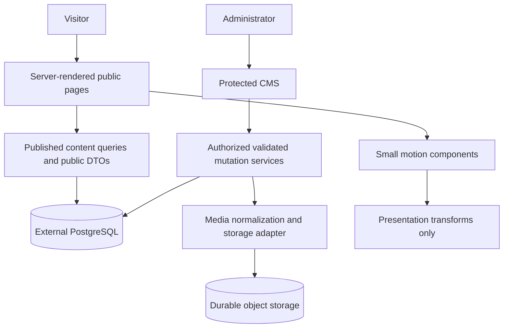

# SAKADO 2.0 — architecture and project audit

Audit: 2026-10-09. Status: production architecture proposal; no rebuild or deployment performed. Confirmed target: **Hostinger managed Node.js Web App hosting**. Exact tier, region, resources and domain: **TO BE CONFIRMED**.

## Evidence and limitations

Inspected: package/lockfile, installed framework guides, route families, Prisma schema/migrations, content policies, auth/permissions, mutation services, media storage, Instagram import/display, assets, existing documentation and test setup. Local PostgreSQL was queried in an explicit read-only transaction; only aggregates and URL matching were reported. These are local development findings, not a production-data audit.

The two requested visual screenshots were not attached or identified in the workspace. `test-results/` contains earlier application QA captures, not the authoritative references. `home-fold-1440.png` was inspected as historical implementation evidence only. The two references, once supplied, govern composition, hierarchy and visual treatment; never copy their unrelated text, business claims or assets. Reference-specific design decisions are **TO BE CONFIRMED**.

At the Phase 00 audit there was no `.git` entry or Git command on PATH. Phase 00.5 established local history: baseline commit `0a0c542`, tag `phase-00-baseline`, approved local identity `SAKADO Local Baseline <baseline@localhost>`, and a verified external Git bundle. No remote is configured and nothing has been pushed. See the Phase 00.5 recovery record in [DEPLOYMENT](DEPLOYMENT.md).

## Phase 00.5 safety status

The existing application and Prisma schema are preserved. A full PostgreSQL custom-format dump was created and restored into a separate disposable local database. All 15 tables (14 application models plus Prisma migration history), row fingerprints, columns, indexes, constraints and enums matched; the source database was unchanged. All 45 Instagram records retain `published=false`, `showOnHomepage=false` and generic media type. The hardware-image record remains authorized/published and untouched.

The single uploaded WebP was copied outside the repository and matched by SHA-256. Backup access is restricted to the local user and SYSTEM. Backups are local recovery copies, not off-device backups or proof of encryption at rest. Current local uploads still require a durable external adapter before managed deployment; this phase documents that migration without implementing it.

Safety changes declare Node 24.x, add a separate `start:hostinger` script, generate Next route types before TypeScript, harden ignore rules, and provide an empty production environment template. No dependencies were upgraded. A manual Ubuntu/Node 24 CI workflow is prepared with pinned actions, dummy DB settings and no deployment or DB-fixture steps. Local Linux execution is unavailable (WSL not installed; no Docker), so Linux compatibility remains unverified until an authorized workflow run.

The isolated Windows Node 24 clean install, Prisma generation, typecheck, ESLint, 15 unit tests, production build, Sharp encoding and demo startup/PORT smoke checks passed. Linux is explicitly NOT RUN. Current validation results and the exact recovery procedure are recorded in [DEPLOYMENT](DEPLOYMENT.md). This phase does not authorize Phase 01 or public deployment.

## Current architecture

Phase 01 now adds opt-in frontend tokens/primitives and GSAP 3.15.0/ScrollTrigger utilities on branch `feat/phase01-motion-foundation`. The table below describes the audited domain application; its routes, CMS/auth, Prisma schema, uploads and Instagram behavior are preserved. The development-only `/dev/motion` laboratory returns 404 in production and is absent from public navigation. See [PHASE_01](PHASE_01.md) for the implemented API, validation, performance exception and stop point. The user's Phase 01 frontend scope supersedes the numbering of the original proposed roadmap; it does not authorize its CMS/schema phases.

| Layer        | Verified implementation                                                                                                |
| ------------ | ---------------------------------------------------------------------------------------------------------------------- |
| Runtime      | Local Node 24.19.0; lockfile/installed Next 16.4.0 and React/React DOM 19.3.0                                          |
| Tooling      | Strict TypeScript 5.9.3, ESLint 9, Prettier, Playwright 1.63.0, tsx                                                    |
| Data         | Prisma/client 6.19.3, PostgreSQL, 14 models, 2 applied migrations                                                      |
| Rendering    | App Router and server components; root `force-dynamic`; React `cache()` deduplicates render-time reads                 |
| UI           | Plain CSS and system fonts; opt-in neutral primitives and GSAP/ScrollTrigger foundation; no WebGL                      |
| CMS          | Event/program/category/destination/gallery/site/settings/user editors, Instagram, messages, registrations, CSV exports |
| Auth         | Argon2id with legacy scrypt verification; opaque 8-hour database sessions; OWNER/ADMIN/EDITOR                          |
| Security     | Zod 4.6.5, permission checks, origin checks, bounded request readers, DB rate limiting, audit records, CSP             |
| Media        | Sharp 0.35.5 normalizes uploaded raster images; only local storage adapter exists                                      |
| Transactions | Registration creation/update, capacity checks, idempotency, serializable retries, manual payment-status labels         |
| SEO          | Metadata, sitemap, robots, OpenGraph image, conditional structured data, French document language                      |

Package ranges differ from resolved versions: for example `next ^16.0.0`, `react ^19.2.0`. Use the lockfile with `npm ci`.

### Documentation drift

README, PROJECT_CONTEXT and VALIDATION describe an earlier nine-model SQLite application, deferred editors and disabled reservations. Current source/schema supersede those statements. `AUTH_SECRET` and `AdminSession` are current; README's `SESSION_SECRET` setup is stale. Existing booking code does not establish business approval to operate it. INSTAGRAM_MEDIA documents the newer implementation more accurately, but its past build/E2E reports are historical. Reconcile older documentation in Phase 1. Domains in `.env.example` are examples, not confirmed Sakado domains.

## Actual content inventory

Repository-confirmed context is SAKADO SFAX, camping/hiking/outdoor adventures in Tunisia, French initial interface, and Instagram `https://www.instagram.com/sakado_sfax/?hl=fr`. Sources: `src/data/confirmed/site.ts` and `docs/PROJECT_CONTEXT.md`. This is not independent verification of legal identity or marketing approval.

| Content                                  | Local findings                                                                             | Decision                                                                                                    |
| ---------------------------------------- | ------------------------------------------------------------------------------------------ | ----------------------------------------------------------------------------------------------------------- |
| Existing copy                            | Name, tagline, hero heading, short about, CTA/footer in confirmed fallback                 | Retain; owner reviews launch copy                                                                           |
| Story/mission/values/year/metrics        | Null/empty defaults; 0 SiteSettings rows                                                   | **TO BE CONFIRMED**                                                                                         |
| Events/categories/destinations/schedules | 0 rows in each                                                                             | No invented locations, dates, prices or capacity                                                            |
| Instagram                                | 45 source links match 45 database rows                                                     | All unpublished, homepage disabled, generic type, zero previews                                             |
| Gallery                                  | 1 CONFIRMED, authorized, published row; 1 WebP upload                                      | Visually an unrelated Raspberry Pi/hardware assembly diagram; content review is a launch blocker; unchanged |
| Official photography/logo/fonts          | No verified Sakado photo set, logo or font assets identified                               | **TO BE CONFIRMED**                                                                                         |
| Placeholder assets                       | camp.svg 1,639 B; coast.svg 765 B; trail.svg 804 B; temporary wordmark/favicon/admin icons | Development placeholders, not approved brand assets                                                         |
| Demo data                                | Separate fictional adventures/destination universes in `src/data/demo/content.ts`          | Never promote implicitly to confirmed content                                                               |
| Partners/community                       | No Partner model; community fallback copy, no verified metrics                             | **TO BE CONFIRMED**                                                                                         |
| Contacts/legal                           | No DB settings; environment contact values not inspected; provisional privacy page         | Channels, legal entity, privacy owner and text **TO BE CONFIRMED**                                          |

Operational counts: AdminUser 1, AdminSession 1, AuditLog 3, RateLimit 3; Booking, ContactMessage and SocialLink each 0. A database authorization flag alone does not establish relevance or rights.

### Reuse map

| Existing module                                                                          | Incremental treatment                                                           |
| ---------------------------------------------------------------------------------------- | ------------------------------------------------------------------------------- |
| `lib/content.ts`, `settings.ts`, content/event policies                                  | Preserve publication rules; add bounded homepage queries and DTOs               |
| EventCard, DestinationCard, ExperienceCategory, EventProgram, SectionHeading, ContactCTA | Reuse semantics/data; restyle through shared tokens                             |
| SiteHeader, MobileNavigation, SiteFooter, Brand                                          | Retain navigation/skip link; enhance transparent/sticky behavior                |
| Gallery                                                                                  | Keep filtering/modal; add static links and optional CSS perspective layout      |
| InstagramMediaMarquee/Card/Dialog/Gallery                                                | Preserve data, import, pagination, pause and selection behavior                 |
| Auth, permissions, admin forms/mutations, throttling/audit                               | Extend existing CMS; harden findings rather than replace                        |
| Storage interface and normalization                                                      | Add durable adapter and metadata while preserving current media URLs            |
| Contact and registration services                                                        | Preserve; keep domain behavior separate from visual work                        |
| Legacy SQLite/export/restructuring artifacts                                             | Preserve for reconciliation; never rerun one-off transformation scripts blindly |

### Instagram provenance

Source: `src/data/instagram-media.json`; importer: `scripts/import-instagram-media.ts` and `lib/instagram-import.ts`; migration: `20261007150000_instagram_media`. Admin UI: `/admin/instagram`; API: `POST /api/admin/instagram`. Public display: homepage, `/gallery?view=instagram`, related event pages via `lib/instagram-content.ts`.

All **45/45** canonical input URLs matched local database rows without running an import. Imports normalize URLs, skip duplicates and default to unpublished generic INSTAGRAM_MEDIA. Homepage selection is capped at 16; library pages at 24. Related events/destinations and previews must also be public/authorized. There is no scraping, Meta integration, embedded player or fetched thumbnail. A URL does not prove media type, availability or usage rights.

## Proposed architecture

Keep one Next.js application for public pages, protected CMS and server endpoints, hosted on managed Hostinger Node 24, backed by external managed PostgreSQL and durable object storage. Provider, region and budget are **TO BE CONFIRMED**. No second backend, replacement CMS or WebGL engine is needed.



Pages call server-only services directly, not their own HTTP API. Public DTOs contain only approved display fields. No ORM records, credentials, personal data or internal notes enter motion props. Mutation flow: authentication → permission → origin/body/schema validation → domain validation → transaction/audit → invalidation. Motion never performs a business mutation.

Proposed directories, introduced only as needed:

```text
src/app/(public)/          existing route URLs
src/app/admin/             existing CMS
src/app/api/admin/         existing contracts plus narrow extensions
src/components/home/      section composition
src/components/motion/    parallax, reveal, gallery depth, preferences
src/components/ui/        shared accessible primitives
src/lib/home/             bounded queries, DTOs, section validation
src/styles/               shared opt-in tokens and primitives (Phase 01)
```

Keep existing domain services in `src/lib`; avoid an unrelated wholesale file move.

## Sitemap

| Routes                                                                                       | Treatment                                               |
| -------------------------------------------------------------------------------------------- | ------------------------------------------------------- |
| `/`                                                                                          | Cinematic homepage with ten sections below              |
| `/experiences`                                                                               | Activities overview using confirmed enabled categories  |
| `/events`, `/events/[slug]`                                                                  | Preserve discovery/details and current program behavior |
| `/destinations`, `/destinations/[slug]`                                                      | Preserve catalogue and honest empty states              |
| `/gallery`, `/gallery?view=instagram`                                                        | Preserve photos/Instagram filtering and pagination      |
| `/about`, `/contact`, `/privacy`                                                             | Approved story, inquiries, reviewed privacy text        |
| `/admin/login`, `/admin`                                                                     | Existing login/dashboard                                |
| `/admin/events`, `/new`, `/[id]`, `/[id]/edit`, `/[id]/registrations` beneath that prefix    | Existing event lifecycle/program workflows              |
| `/admin/destinations`, `/admin/destinations/new`, `/admin/destinations/[id]`                 | Existing destination editors                            |
| `/admin/gallery`, `/instagram`, `/site`, `/settings`, `/messages`, `/users` beneath `/admin` | Existing CMS resources                                  |
| `/admin/registrations`, `/admin/registrations/[id]`                                          | Restricted operational records                          |
| `/admin/partners`                                                                            | Proposed only if approved partner content requires it   |
| `/sitemap.xml`, `/robots.txt`, `/opengraph-image`, `/media/[key]`                            | Preserve metadata/media contracts                       |

No new payment, account, booking, blog or testimonial scope is implied. Keep slugs; use explicit redirects for later approved URL changes.

## Homepage component contract

| Order | Component             | Content source                       | Enhancement / fallback                                              |
| ----- | --------------------- | ------------------------------------ | ------------------------------------------------------------------- |
| 1     | SiteHeader            | Existing links/settings              | Transparent over hero, solid on scroll/focus/menu; solid without JS |
| 2     | ParallaxHero          | Approved poster/layers, heading, CTA | Static first; 2–3 decorative depth layers                           |
| 3     | StorySection          | Approved story chapters              | Semantic text/images; optional desktop sticky progression           |
| 4     | ActivitiesShowcase    | Confirmed enabled EventCategory      | Keyboard/touch cards; normal list/grid                              |
| 5     | EventsHighlights      | Bounded upcoming/completed events    | Reuse EventCard; no fabricated dates/prices                         |
| 6     | CinematicGallery      | Authorized published media           | CSS 3D presentation over accessible grid/lightbox                   |
| 7     | InstagramMediaMarquee | Existing 16-item query               | Pause/manual controls; static row/external links                    |
| 8     | PartnersCommunity     | Approved partners/community copy     | Omit unapproved partner row and unsupported metrics                 |
| 9     | ContactCTA            | Approved text/contact destination    | Contact/Instagram fallback; no reservation promise                  |
| 10    | SiteFooter            | Settings/social/legal                | Semantic static footer                                              |

All ten positions are designed; unavailable content is not permission to invent it. Preserve order while suppressing unavailable optional rows. Nav/footer are layout components, not arbitrary CMS HTML.

## API and access boundaries

| Boundary                           | Contract                                                                                                                                         |
| ---------------------------------- | ------------------------------------------------------------------------------------------------------------------------------------------------ |
| Public reads                       | Server-side filtered DTOs; proposed home limits: 6 events, 8 activities, 12 photos, 12 partners; Instagram remains 16; paginate full collections |
| Contact/login/logout               | Existing validated Server Actions; inquiry persistence does not mean email delivery or booking                                                   |
| `POST /api/admin/[resource]`       | Allowlisted resource, permission, origin, bounded JSON, shared domain mutation                                                                   |
| `POST /api/admin/media`            | Gallery permission, bounded multipart, decoded raster validation; upload does not publish                                                        |
| `POST /api/admin/instagram`        | Gallery permission today; centralized URL and publication rules                                                                                  |
| `GET /api/admin/exports?eventId=…` | Booking permission, audited escaped CSV, private/no-store; bound/stream large exports                                                            |
| `GET /media/[key]`                 | Key validation and authorized usage before bytes; guessed URL is not permission                                                                  |
| `POST /api/registrations`          | Existing transactional functionality; business operation **TO BE CONFIRMED**                                                                     |

Current permissions: OWNER all; ADMIN all except users/settings; EDITOR dashboard/events/gallery/site/categories, including Instagram via gallery. Editors currently can publish. Proposed workflow: EDITOR drafts, ADMIN/OWNER publish, OWNER identities/settings. Add explicit publication permissions and revisions in Phase 2 after owner confirmation; do not claim these restrictions exist today. Review editor access to dashboard booking aggregates/audit summaries.

Start with current dynamic rendering. Never cache sessions, PII, admin or authenticated previews. React `cache()` is not a persistent cache. Introduce public-only caching after measurement, with invalidation on publication, parent visibility, settings, media authorization and Instagram changes. Cache Components is not enabled; do not switch caching models incidentally. Verify image/CDN withdrawal and cross-instance invalidation before scaling.

## Performance, SEO, accessibility and security

Field targets: p75 LCP ≤ 2.5 s, INP ≤ 200 ms, CLS ≤ 0.1, mobile and desktop separately, following [Core Web Vitals](https://web.dev/articles/defining-core-web-vitals-thresholds?hl=en). These are targets, not measured results. Staging gate: three cold mobile Lighthouse runs with approved media, median Performance ≥ 90, Accessibility ≥ 95, plus manual accessibility tests.

Project budgets: initial compressed JS ≤ 200 KiB including framework, added motion JS ≤ 30 KiB, initial mobile transfer ≤ 1.5 MiB, mobile hero ≤ 250 KiB, desktop hero layers combined ≤ 700 KiB. Record exceptions explicitly. One eager LCP image, reserved dimensions, lazy below-fold media; no auto video or Instagram embeds. Audit current `unoptimized` hero/gallery usage and unbounded content queries before performance claims.

Target WCAG 2.2 AA and additionally disable non-essential motion on request. Require keyboard navigation, visible focus, skip link, meaningful headings/alt text, 44px project touch targets, readable overlays, usable form errors, Escape/focus restoration and 320px/200–400% zoom reflow. No scroll trapping or animation-gated information.

Preserve French language metadata, unique titles, canonical URLs, honest 404s and public-only sitemap. Never invent structured-data ratings, offers, dates or prices. Admin/staging/preview remain noindex; robots is not authorization. Local SITE_URL is unset. Real HTTPS origin and approved content are launch gates.

Preserve active-user/session checks on every protected request; Proxy is not auth. Test CSRF, IDOR, role escalation, upload spoofing, body limits, expired/revoked sessions and concurrent capacity. Current sameOrigin compares hosts and accepts HTTP/HTTPS; harden to configured canonical HTTPS origins and verify Hostinger proxy headers. TRUST_PROXY stays false until trusted header replacement is proven. Current CSP allows inline scripts/styles; test stricter nonce/hash script policy with Next hydration. Add MFA/recovery, least-privilege DB access, retention/erasure, cleanup and monitoring. Providers/policies are **TO BE CONFIRMED**. No secrets or PII in client bundles/logs; service worker keeps only neutral offline/static assets.

## Missing business decisions

All are **TO BE CONFIRMED**:

- Sakado/design: two reference screenshots, official logo/fonts/colors, crops/layers and authorized photography.
- Sakado editorial: official story, mission, values, enabled activities, real events/destinations, partner agreements and substantiated community claims.
- Sakado operations: contact channels, primary CTA, registration approval, hold expiry, waitlist, confirmation, cancellations, prices/currency and meaning of payment statuses.
- Sakado owner/legal: legal identity/privacy text, media consent/credits, retention, CMS roster/publishing roles, MFA/recovery owner.
- Technical owner: exact Hostinger tier/limits, domain, DB/storage provider/region/budget, backups, monitoring, release schedule.
- Editorial/operations: French-only or multilingual scope and content timezone; do not infer event timezone from the operator's machine.
- Owner: analytics/consent requirements; no trackers assumed.

## Risks and controls

| Risk                                 | Required control                                                                 |
| ------------------------------------ | -------------------------------------------------------------------------------- |
| Missing Git baseline and stale docs  | Recoverable snapshot/source control, documentation reconciliation                |
| Lost uploads on redeploy             | Durable storage, checksum reconciliation, old URL compatibility, redeploy proof  |
| Reset/demo import into real DB       | Isolated environments; additive migrations; fixture guards                       |
| Premature registration exposure      | Preserve code; proposed global 2.0 registration gate defaults off until approved |
| 45 links overwritten/published       | Reconcile IDs/URLs/order/flags; no automatic media inference or publication      |
| Unrelated image published            | Owner review; rights/relevance cannot be inferred from flags                     |
| Linux native dependency failures     | Actual-plan Node 24 clean build and runtime smoke                                |
| Proxy/cookie/origin mismatch         | Canonical HTTPS, host-only cookies, forwarded-header verification                |
| Motion harms navigation/performance  | Static first, reduced motion, controls, measured traces                          |
| Cache/media exposes withdrawn drafts | Central policies, preview auth, invalidation/direct-byte tests                   |
| Domain regression during restyling   | Preserve endpoints/schema, small releases and compatible rollback                |

## Implementation phases and acceptance criteria

Each phase is a separate reviewable change; none is implemented by this audit.

| Phase                             | Work                                                                                                                                                                                                  | Exit criteria                                                                                                                                                                   |
| --------------------------------- | ----------------------------------------------------------------------------------------------------------------------------------------------------------------------------------------------------- | ------------------------------------------------------------------------------------------------------------------------------------------------------------------------------- |
| 0 — Audit                         | This document, design/motion/database/deployment specs and AGENTS                                                                                                                                     | 45 URLs reconciled; 14 models inventoried; unknowns explicit; code/data preserved                                                                                               |
| 1 — Baseline/deployment readiness | Establish source recovery/Git; reconcile old docs; environment separation; Node 24 startup/readiness; select external PostgreSQL/object storage; durable adapter preserving media URLs; restore drill | Linux npm ci/generate/typecheck/lint/unit/build pass; test DB guard checked; upload survives restart/redeploy; DB/media restore and 45-row reconciliation; production untouched |
| 2 — CMS foundation                | Additive homepage/media/partner/revision models; preview/publish/versioning; approved role separation; explicit registration release gate                                                             | Unauthorized API/preview/media denied; editor publishing denied under approved policy; old readers work; no arbitrary CMS HTML/code or unapproved CTA                           |
| 3 — Static homepage               | Tokens and ten sections behind proposed server-side HOME_V2_ENABLED flag; reuse content services                                                                                                      | Screenshots supplied before visual sign-off; 320/390/768/1024/1440/1920px layouts; keyboard/no-JS links usable; approved content only; legacy homepage rollback                 |
| 4 — Motion                        | Hero depth, story progress, activity interaction, CSS 3D gallery; reuse Instagram                                                                                                                     | Reduced-motion/no-JS fallback; no scroll trap/focus loss/hydration mismatch; hidden-tab work stops; budgets/traces pass                                                         |
| 5 — Full-site hardening           | Shared design across discovery/detail/contact; CMS/media lifecycle, pagination, measured caching, SEO/security/accessibility fixes                                                                    | URLs/contracts preserved; role/CSRF/publication/media tests pass; isolated DB tests; legal/content sign-off; current dependency review                                          |
| 6 — Staging/release               | Actual Hostinger smoke/load/restore; approved content migration; domain/TLS/monitoring; retain previous release                                                                                       | DEPLOYMENT matrix passes; rollback rehearsal; media/brand/legal approved; measured budgets; no unresolved launch-blocking security issue                                        |

Rollback is application-first: disable the proposed V2 flag or redeploy the previous compatible release. Keep additive schema/data. Contracting schema or deleting old code/assets is a later separately reviewed phase, never a database reset.

## Validation and exact next step

- This audit reran `npm test`: **15 passed, 0 failed**.
- Read-only local DB inventory confirmed two completed migrations and all **45/45** canonical Instagram matches.
- Existing QA screenshot and uploaded WebP were visually inspected; primary screenshots remain unavailable.
- No migration/import/seed/account/publication/deployment executed. Full build, E2E, integration and vulnerability scans were not rerun for this documentation-only change; historical reports do not prove current readiness.

**Phase 01 stop point:** the explicitly requested frontend foundation and isolated motion engine are implemented; the real homepage is preserved. Wait for an explicit Phase 02 specification, official screenshots/assets and content decisions before homepage integration. Review the measured motion bundle exception and profile on representative devices. Linux execution, durable external storage and actual Hostinger staging remain separate deployment-readiness gates; no push/deployment is authorized. See [PHASE_01](PHASE_01.md).

Specifications: [DESIGN_SYSTEM](DESIGN_SYSTEM.md), [MOTION_SYSTEM](MOTION_SYSTEM.md), [DATABASE](DATABASE.md), [DEPLOYMENT](DEPLOYMENT.md).

## Phase 02 implementation addendum — cinematic navigation

The user's explicitly scoped Phase 02 is navigation, superseding the older roadmap's numbering for the current task. See [PHASE_02](PHASE_02.md). `SiteHeader` remains server-rendered and passes the existing `Brand` as a React slot to the small client `NavigationShell`. Public settings/logo fetching, main content, footer and business services stay on their existing boundaries. Verified public routes live in a pure navigation module; the only prominent action is the existing `/events` discovery route.

The sticky header observes the direct homepage element `#main > [data-navigation-hero="dark"]`. IntersectionObserver switches appearance at the hero's boundary; ResizeObserver reconnects only when header height changes. Native scrolling, server content and Phase 01 motion timelines remain independent. A fixed-height header and matching homepage overlay margin preserve layout; the old hero receives only a marker and header clearance. Non-home routes, unavailable APIs and no-JS rendering use a readable solid surface. Mobile navigation uses native dialog/inert semantics, focus cycling, Escape, restoration, route/breakpoint cleanup and a disclosure fallback.

No database/schema/auth/CMS/media behavior changed. Local recovery starts from validated Phase 01 commit `8d7995b` on `feat/phase02-cinematic-navigation`. Phase 02 is ready for the separately authorized hero phase; no Phase 03 implementation, push or deployment is included. Official brand/media and final hero content remain TO BE CONFIRMED. Linux execution, durable storage, mobile profiling and Hostinger staging remain separate gates.

## Phase 03 implementation addendum — cinematic hero

The explicitly requested hero phase is implemented on `feat/phase03-cinematic-hero`, based on validated navigation commit `22ca885`. Only the old hero markup is replaced with server-renderable `ParallaxHero`; all following sections and existing queries remain intact. `HeroBackground`, `HeroContent` and `HeroActions` share a scoped CSS module. Existing settings supply the title, tagline and explicit media path. The reference `design-references/sakado-hero.png` was confirmed by the user after the requested alternate filename was found missing.

`resolveHeroMedia` never queries gallery records or promotes a media authorization flag into brand approval. With no selected scenic asset, development uses a visibly labeled existing illustration; production renders a static dark composition with no hero image or GSAP import. Known placeholder SVGs cannot be enabled in the production hero by DEMO_MODE. A selected allowed image enables a single decorative parallax plane, not fake independent depth layers. Real imagery, crops, rights and official brand assets remain TO BE CONFIRMED.

The rounded white frame, semantic copy, immediately usable CTAs and overlapping three-link discovery panel stay in normal flow. The outer section is the stable Phase 02 observer boundary; no navbar code or timeline is rebuilt. Optional motion extends the existing engine with bounded scale/text effects and exact style restoration across breakpoint/preference cleanup. Controls stay outside transformed/revealed wrappers. See [PHASE_03](PHASE_03.md) for actual checks, screenshots, bundle/performance evidence and limitations. This was the Phase 03 stop point; Website Phase 04 was subsequently authorized separately.

## Website Phase 04 — motion and publication readiness

The new request authorizes incremental About/activity/CSS-gallery motion and MEDIA-04 enforcement, not photo approval. See [PHASE_04](PHASE_04.md) for exact scope, data boundary and verification. Existing hero/navigation/Instagram architecture is reused. Server loaders and mutation/upload/media routes consult an identity-bound, read-only readiness registry before exposing known library images. Static public files receive a build preflight. Authenticated `/admin/media-readiness` shows safe review metadata without private evidence or original previews. The existing role matrix and schema remain intact. All 17 library assets and 85 approval fields retain their original blocked/pending state. Approved-photo choreography and hosting/privacy clearance remain unresolved; stop after this separately authorized Website Phase 04.
