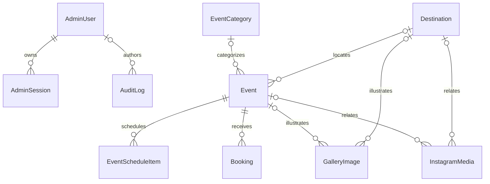

# SAKADO 2.0 — database and media specification

Audit: 2026-10-09. Active schema: `prisma/schema.prisma`, **PostgreSQL / Prisma 6.19.3**. This document proposes additive changes; no migration, import, seed or data mutation was performed.

## Current schema and local inventory

Counts were read from the configured local PostgreSQL database in a READ ONLY transaction. They do not describe production.

| Model             | Count | Role / keys / relationships                                                                |
| ----------------- | ----- | ------------------------------------------------------------------------------------------ |
| AdminUser         | 1     | Unique email, passwordHash, active, OWNER/ADMIN/EDITOR; sessions/audit                     |
| AdminSession      | 1     | Unique tokenHash, admin FK, expiry; admin delete cascades                                  |
| RateLimit         | 3     | HMAC key PK, count, expiry index; shared across processes                                  |
| AuditLog          | 3     | Optional admin FK SetNull, action/entity reference, createdAt index                        |
| EventCategory     | 0     | Unique slug, enabled/order/source; events                                                  |
| Event             | 0     | Unique slug, publication/source/lifecycle, optional category/destination SetNull, version  |
| Booking           | 0     | Unique reference/idempotencyKey; required event FK Restrict; contacts, count, money/status |
| Destination       | 0     | Unique slug, publication/archive/source, optional coordinates; events/media                |
| EventScheduleItem | 0     | Required event FK Cascade; day/time/order/title                                            |
| GalleryImage      | 1     | src/alt, authorized/published/source; optional event/destination SetNull                   |
| ContactMessage    | 0     | Contact details, subject/message, read/archive flags                                       |
| SiteSettings      | 0     | Singleton convention id=main, JSON content, optional social labels                         |
| SocialLink        | 0     | Label, URL, enabled/order                                                                  |
| InstagramMedia    | 45    | Unique canonical URL, type, preview path, flags/order; optional event/destination SetNull  |

Applied migrations:

1. `20261007091345_sakado_admin_postgresql`
2. `20261007150000_instagram_media`

Both have completed timestamps in local migration history. Legacy SQLite schema/migrations remain under `prisma/legacy-sqlite/`; `prisma/dev.db`, `prisma/e2e.db`, `.local/legacy-sakado.db` and `.local/legacy-export.json` also exist. They are preserved historic artifacts, not the active schema or current test-database contract. No legacy record contents were exported during this audit. The embedded local PostgreSQL helper is development tooling, not a production database service.

Current coverImage/previewImage and SiteSettings media paths are strings, not media foreign keys. Usage guards in application code protect some references, but database-level asset integrity is incomplete. SiteSettings singleton status is an application convention, not a DB constraint limiting the entire table to one row.

## Publication and transactional invariants

- Confirmed public events: published + CONFIRMED, excluding DRAFT/CANCELLED/ARCHIVED. Destinations additionally exclude archived. Gallery also requires authorized + published + CONFIRMED and eligible parents.
- Instagram requires published and eligible parents. A preview is emitted only if its GalleryImage is authorized, published, confirmed and has public parents. Homepage additionally requires showOnHomepage. All 45 local rows currently fail publication by design.
- The uploaded WebP is marked authorized/published but visibly depicts hardware. Retain it during this audit; owner must review before launch. Authorization flags do not establish content provenance.
- Admin session token hashes, never raw tokens, are persisted. Role/active state is read from the database. Current eight-hour expiry is implementation behavior, not an approved organizational session policy.
- Event writes use a version check; not every CMS resource has conflict detection. Do not imply all editors are already protected from lost updates.
- Existing PENDING/CONFIRMED/COMPLETED bookings consume capacity; WAITLIST/CANCELLED do not. Pending holds have no implemented TTL. Registration requires an eligible future event, permitted registration status, price and capacity, and is blocked in demo mode.
- Booking creation is idempotent and serializable, with capacity checked server-side and up to five attempts on Prisma P2034 conflicts. Existing idempotency equivalence checks event/email/count; review full payload semantics separately.
- Amount is calculated from DB price; Booking.totalAmount uses Decimal(12,3), Event.price is nullable Decimal, currency defaults to TND and event mutation currently fixes TND. This is existing code, not approval of prices, currency or tax policy.
- There is no Payment or Participant model, gateway or settlement reconciliation. PaymentStatus labels are manual state, not proof of money received. Do not invent payment/booking functionality.
- Archive referenced events; Booking's Restrict FK protects history. Never remove FK restrictions to make deletes succeed.

Business rules for holds, waitlists, cancellation, notification, participant data, money/currency and retention are **TO BE CONFIRMED**. Preserve existing records/services; add a proposed global registration-release gate defaulting off for 2.0 until operational approval, without deleting the existing system.

## Additive target model

Use typed, bounded sections rather than an unrestricted page builder. Names below are proposals, not existing tables.

| Entity                         | Proposed minimum fields / constraints                                                                                                                                                                                         |
| ------------------------------ | ----------------------------------------------------------------------------------------------------------------------------------------------------------------------------------------------------------------------------- |
| MediaAsset                     | id; unique storageKey; provider; MIME; byteSize; width/height; checksum; alt/caption/credit; rightsStatus PENDING/APPROVED/REVOKED; rightsEvidenceRef; authorizedAt/by; focalX/focalY in 0–1; createdAt/updatedAt; archivedAt |
| HomePage                       | singleton id=home; optional publishedRevisionId; draftRevisionId; version; timestamps                                                                                                                                         |
| HomeRevision                   | id, pageId FK, revisionNumber unique per page, status DRAFT/REVIEW/PUBLISHED/ARCHIVED, schemaVersion, createdBy/approvedBy FK, approvedAt/publishedAt                                                                         |
| HomeSection                    | id, revisionId FK, sectionKey enum, enabled, order, schemaVersion, strictly validated content JSON; unique revisionId+sectionKey                                                                                              |
| SectionMedia                   | sectionId FK, assetId FK, slot enum (poster/background/middle/foreground/story), order, decorative; unique section+slot+order                                                                                                 |
| Partner                        | id, unique slug, approved name, HTTPS website optional, logoAssetId FK, rightsApproved, published=false, order, timestamps/version                                                                                            |
| GalleryImage.assetId           | Nullable MediaAsset FK during migration; eventually required for stored uploads after reconciliation                                                                                                                          |
| InstagramMedia.previewAssetId  | Nullable MediaAsset FK; keep original URL/ID/order/flags and legacy previewImage during transition                                                                                                                            |
| Event/Destination.coverAssetId | Nullable MediaAsset FK; keep coverImage until all readers migrate                                                                                                                                                             |

HomeSection keys are HERO, STORY, ACTIVITIES, EVENTS, GALLERY, INSTAGRAM, COMMUNITY_PARTNERS, CTA. Header/footer remain shared layout/settings. Order is constrained to the required narrative sequence. Content JSON is a discriminated Zod schema: heading/text/approved CTA, bounded story chapters and bounded selection preferences. No raw HTML, scripts, CSS, executable animation config or unvalidated arbitrary URLs. SectionMedia resolves approved assets; image rights are enforced on read as well as publish.

Technical motion presets live in source code. CMS may select an allowlisted preset and approved media, not scroll distances or executable timelines. Activity/event/gallery/Instagram collections reference existing models and central public selectors; do not duplicate transactional data in a homepage JSON blob.

Relations: HomePage has many revisions; a revision has many sections; sections have many SectionMedia records; MediaAsset can serve many sections/gallery/cover/preview/partner references. Required asset references use Restrict for deletion. Revisions may cascade to their owned sections only after retention rules permit revision deletion. Actor FKs may SetNull to retain history. Draft/approved/published revision transitions and HomePage pointer changes occur atomically with version checking and an audit event. Approved revisions are immutable; editing creates a draft copy. Assets referenced by a revision must pass the current rights policy even if they were previously approved.

Partner edits must not overwrite live approved content silently: keep draft changes in a revision payload or add PartnerRevision if the agreed editorial workflow needs independent partner publishing. Do not create records without real partner approval.

## Draft, preview, publish and access control

1. EDITOR creates/edits validated drafts, with optimistic version checking.
2. Authenticated preview resolves a specific draft revision; private/no-store, noindex, no public token in a URL. Preview permission is checked on every request, including media bytes.
3. ADMIN/OWNER reviews business claims, link destinations, rights, alternative text and section completeness; explicit publish permission required under the proposed role policy.
4. Transaction marks the immutable revision published and switches the page pointer. Audit actor/entity/version; invalidate relevant public reads.
5. Unpublish/rollback switches to another approved revision or a safe baseline; no deleting historical rows.

This differs from current broad resource permissions, where EDITOR can publish event/gallery/site content. Role changes require confirmation and focused migration tests. Protect booking/contact personal data separately from editorial content.

## Durable media strategy

Implement a remote adapter behind existing MediaStorage. Prefer a private object bucket and policy-controlled `/media/[key]` gateway initially, preserving current URLs. Public CDN derivatives may follow only with an explicit withdrawal/purge design; do not use irreversible public caching for revocable/private assets. Provider and region are **TO BE CONFIRMED**.

Retain current upload defenses: JPEG/PNG/WebP only, 10 MiB file limit, 11 MiB bounded multipart request, actual decoder format validation, 40-million-pixel input limit, EXIF-stripping re-encode, maximum 2400×2400 inside-fit, randomized WebP keys, bounded alt text and role/rate limits. SVG uploads remain disallowed; reviewed repository SVGs are separate. Record dimensions/checksum/rights/credits. A future transparent hero cutout must be approved and validated; do not generate fake Sakado photos.

Write object then transactional metadata; compensate failed DB writes and record failed cleanup for a scheduled reconciler. Never delete a referenced asset synchronously because an editor removes one gallery entry. Archive, check all usages, retain recoverable objects, and garbage-collect only after the agreed grace/retention period. Metadata and storage cannot share a SQL transaction, so document/retry partial failures.

Migrate local objects by copying with stable keys, validating byte hashes/metadata, then dual-reading remote-first/local-fallback during transition. Preserve all existing path strings while adding asset FKs. Do not remove local originals until a restore/redeploy rehearsal and agreed retention period. New uploads use one selected writer to avoid divergent stores.

## Migration and integrity runbook

1. Confirm authoritative environment; snapshot code, schema, DB and media separately. Encrypt backups; record counts/checksums without PII in reports.
2. Restore into an isolated staging database/storage namespace; prove old application reads it. Never run fixture setup on real data.
3. Apply additive migrations only. New nullable columns/tables first; do not edit applied migrations.
4. Backfill in bounded idempotent batches with checkpoint/provenance, retaining IDs, slugs, references, flags, timestamps and canonical URLs.
5. Reconcile old/new counts, unique constraints, asset hashes, orphan references and publication behavior. Specifically retain all 45 Instagram rows unpublished/homepage-off unless separately curated.
6. Release compatible readers/writers and test admin/public/media policy; monitor. Schema contraction is a later change after rollback compatibility expires.
7. Roll back application first; keep compatible additive schema. Restoring an older DB over new writes requires an explicit reconciliation plan, not an automatic deployment rollback.

Candidate DB checks: participantCount > 0; capacity ≥ 0; prices/amounts ≥ 0; end ≥ start where both dates exist; focal points bounded; revision/order uniqueness. Review current rows before adding constraints. Keep money as Decimal and timestamps in UTC; editorial timezone is **TO BE CONFIRMED**. Add indexes from measured access paths, not guesswork: homepage section order, asset usages, partner publication/order and revision lookups. Existing event/booking/Instagram/session indexes are reusable.

Operational targets proposed: daily encrypted backup plus provider point-in-time recovery where available; RPO ≤ 24h, RTO ≤ 4h until owner agrees stronger requirements. Confirm actual provider capability/cost and retention. Expired sessions/rate limits need scheduled cleanup (currently cleanup occurs on successful login). Contact/booking/audit/media retention and erasure procedures require owner/legal decisions; do not invent statutory periods.

## Database acceptance

Test additive migration and rollback compatibility on restored data; duplicate import idempotence; source/demo exclusion; parent withdrawal; direct media authorization; role denial; revision conflicts; atomic publishing; checksum-preserving media migration; and, if existing registrations remain enabled, idempotency/capacity under concurrent requests. The existing integration/E2E setup deletes fixture rows in a guarded local `sakado_test` database: inspect guards before running. Do not point it at staging or production.
